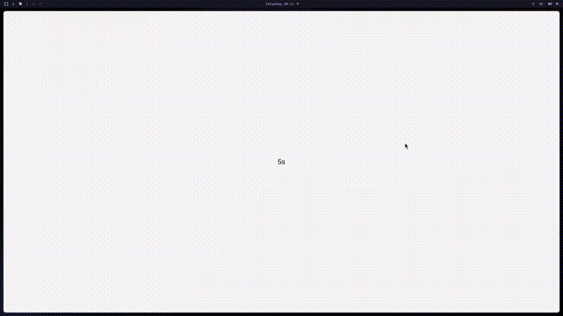

## About

KIdleWatcher is a small Qt/QML component that watches for user inactivity and fires a signal when the timeout is reached. It was built for kiosk and point-of-sale style screens, where an idle display should fall back to a screensaver and wake up as soon as someone touches it.

The idle detection lives in C++ and is exposed to QML, so using it is a few lines of declarative code.

It also started as an experiment: a test to build a component entirely in C++ and expose it to QML, instead of writing it in QML with C++ helpers. KIdleWatcher is that test turned into a small, reusable library.

## Usage

```qml
import KIdleWatcher 1.0

KIdleWatcher {
    id: idleWatcher
    timeout: 30000  // ms until the screensaver triggers
    Component.onCompleted: start()
    onIdle:   screensaver.show()
    onActive: screensaver.hide()
}
```

## How it works

Instead of placing an input item over the UI, KIdleWatcher installs a Qt **event filter** on the application object. Every input event goes through the filter before it reaches its target, so the watcher can restart its idle timer without ever consuming or changing the event.

```cpp
bool KIdleWatcher::eventFilter(QObject *watched, QEvent *event)
{
    switch (event->type()) {
    case QEvent::MouseMove:
    case QEvent::MouseButtonPress:
    case QEvent::KeyPress:
    case QEvent::TouchBegin:
    case QEvent::TouchUpdate:
        resetTimer();
        break;
    default:
        break;
    }
    return QObject::eventFilter(watched, event); // never swallow the event
}


```

### Exposing a C++ class to QML

The whole component is a plain `QObject` subclass. `Q_PROPERTY` gives QML the `timeout` property, `Q_INVOKABLE` exposes `start()`, and the signals map directly to the `onIdle`, `onActive` and `onReset` handlers.

```cpp
class KIdleWatcher : public QObject
{
    Q_OBJECT
    Q_PROPERTY(int timeout READ timeout WRITE setTimeout NOTIFY timeoutChanged)

public:
    explicit KIdleWatcher(QObject *parent = nullptr);

    int timeout() const { return m_timer.interval(); }
    void setTimeout(int ms) { m_timer.setInterval(ms); emit timeoutChanged(); }

    Q_INVOKABLE void start();

signals:
    void idle();
    void active();
    void reset();
    void timeoutChanged();

protected:
    bool eventFilter(QObject *watched, QEvent *event) override;
    // ...
};
```

The type is then registered so QML can import it:

```cpp
qmlRegisterType<KIdleWatcher>("KIdleWatcher", 1, 0, "KIdleWatcher");
```
### Event filter vs MouseArea

A `MouseArea` could also be used to detect activity, but it solves a different problem: it reacts to input inside one item. An application-wide idle watcher needs to see input everywhere.

| | Event filter (KIdleWatcher) | MouseArea |
|---|---|---|
| Scope | Whole application, any screen, popup or window | Only inside its own geometry |
| Input types | Mouse, keyboard, touch, wheel, tablet | Mouse (touch is synthesized), no keyboard |
| Setup | One instance, no changes to existing screens | Must be added to every screen and kept on top |
| Interferes with the UI | No, the event is passed along untouched | Can block items below it unless propagation is handled |
| Pure QML | No, needs C++ | Yes |
| Performance | Sees every event, so the filter must be cheap | Only handles events for its own area |


## Signals

| Signal | Description |
|---|---|
| `idle()` | Emitted when the timeout is reached |
| `active()` | Emitted when the user returns after being idle |
| `reset()` | Emitted on every input event |

## Qt 5 and Qt 6

The repository ships both builds: CMake for Qt 6 and a qmake `.pro` file for Qt 5, each with its own QML entry point. It is open source on [GitHub](https://github.com/kastico/KIdleWatcher).
